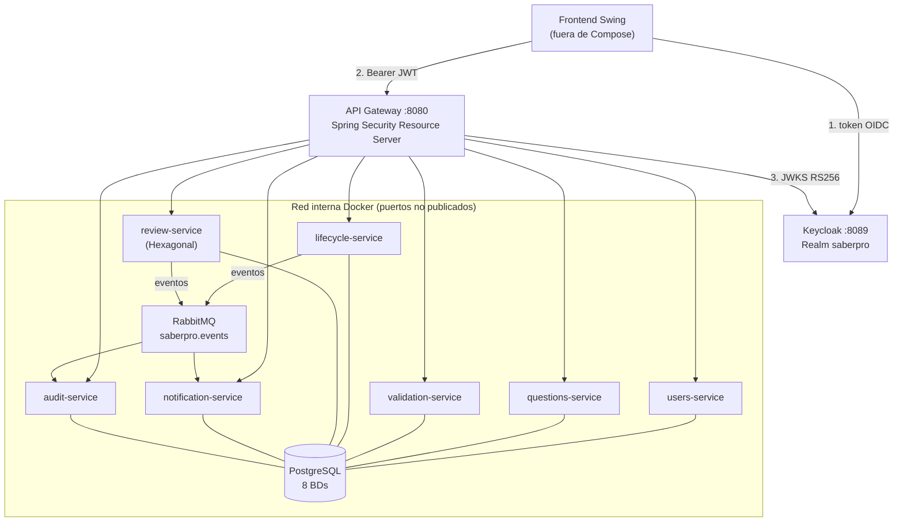

# Banco de Preguntas Saber Pro — SF2

[](https://github.com/cristiang00/banco_preguntas_sf2/actions/workflows/ci.yml)
[](https://adoptium.net/)
[](https://spring.io/projects/spring-boot)
[](https://docs.docker.com/compose/)

Sistema distribuido de gestión y revisión de preguntas para el examen Saber Pro de la Universidad del Cauca, desarrollado con microservicios Spring Boot, arquitectura hexagonal en `review-service`, seguridad con Keycloak + Spring Security OAuth2 Resource Server (JWT RS256) y mensajería RabbitMQ.

---

## Tabla de Contenidos

- [Arquitectura](#arquitectura)
- [Requisitos](#requisitos)
- [Inicio Rápido con Docker](#inicio-rápido-con-docker)
- [Ejecución del Frontend Swing](#ejecución-del-frontend-swing)
- [Usuarios de Prueba y Gestión en Keycloak (Postman Admin REST API)](#usuarios-de-prueba-y-gestión-en-keycloak-postman-admin-rest-api)
- [URLs y Puertos](#urls-y-puertos)
- [Desarrollo Local sin Docker](#desarrollo-local-sin-docker)
- [Pruebas](#pruebas)
- [Estructura del Proyecto](#estructura-del-proyecto)
- [Sprint 3 — Estado del Cierre](#sprint-3--estado-del-cierre)

---

## Arquitectura

El sistema sigue una **arquitectura de microservicios** con API Gateway centralizado, **Keycloak** como proveedor único de identidad (OIDC / RS256) y **Spring Security OAuth2 Resource Server + `@PreAuthorize`** en el gateway y en los 7 microservicios:

```
Frontend Escritorio (Java Swing — fuera de Compose)
      │  1. POST /token (OIDC) ──────────► Keycloak :8089 (Realm saberpro / RS256)
      │  2. HTTP + Authorization: Bearer JWT
      ▼
 API Gateway :8080 (Spring Security Resource Server — JWKS)
      │  Bearer JWT verificado + X-Correlation-Id
      ├──► users-service        (:8081 interno — gestión de usuarios, sin emisor JWT propio)
      ├──► questions-service    (:8082 interno — Builder, Facade, versiones anteriores)
      ├──► validation-service   (:8083 interno — motor de reglas estructurales)
      ├──► lifecycle-service    (:8084 interno — máquina de estados / patrón State)
      ├──► review-service       (:8085 interno — Arquitectura Hexagonal)
      ├──► notification-service (:8086 interno — Factory Method, SMTP real + RabbitMQ)
      └──► audit-service        (:8087 interno — Observer + RabbitMQ)

Mensajería: RabbitMQ exchange saberpro.events
BD:         PostgreSQL (8 bases de datos independientes + volumen postgres-data)
Correo:     Mailpit (SMTP :1025 / UI :8025)
```

### Diagrama C4 — Contenedores (Iteración 3)



Consulta el documento completo de arquitectura en [`docs/Documento-Arquitectura-Sprint3.pdf`](docs/Documento-Arquitectura-Sprint3.pdf) y su fuente Markdown en [`docs/arquitectura-sprint3.md`](docs/arquitectura-sprint3.md).

---

## Requisitos

| Herramienta | Versión mínima |
|-------------|---------------|
| Docker Desktop | 4.x |
| Java JDK | 17 (Temurin) |
| Maven / Maven Wrapper | 3.9+ o `mvnw.cmd` |

---

## Inicio Rápido con Docker

```powershell
# 1. Copiar y ajustar variables de entorno
Copy-Item .env.example .env

# 2. Construir imágenes multi-stage (sin compilar nada antes) y levantar todo el stack
docker compose up --build -d

# 3. Verificar que todos los contenedores estén healthy
docker compose ps
```

> **Nota:** El primer arranque compila `contracts` y los 8 servicios dentro de los contenedores multi-stage e importa automáticamente `docker/keycloak/saberpro-realm.json`.

### Parar y conservar / borrar volúmenes

```powershell
# Parar conservando datos de PostgreSQL (postgres-data) y Keycloak (keycloak-data)
docker compose down

# Parar y borrar volúmenes (elimina bases de datos)
docker compose down -v
```

---

## Ejecución del Frontend Swing

El cliente `frontend` es una aplicación de escritorio Java Swing y queda **fuera de Docker Compose**, conectándose al API Gateway mediante la variable de entorno `GATEWAY_URL` y a Keycloak mediante `KEYCLOAK_TOKEN_URL`.

### Contra el sistema levantado con Docker Compose (recomendado)

```powershell
# Compilar el módulo frontend (incluye contracts)
.\mvnw.cmd -pl contracts,frontend -am package -DskipTests

# Configurar URLs (valores por defecto ya apuntan a localhost:8080/api/v1 y localhost:8089)
$env:GATEWAY_URL = "http://localhost:8080/api/v1"
$env:KEYCLOAK_TOKEN_URL = "http://localhost:8089/realms/saberpro/protocol/openid-connect/token"

# Ejecutar cliente de escritorio
java -jar frontend\target\frontend-2.0.0-SNAPSHOT.jar
```

---

## Usuarios de Prueba y Gestión en Keycloak (Postman Admin REST API)

### Usuarios precargados en `saberpro-realm.json`

| Usuario | Contraseña | Rol |
|---------|-----------|-----|
| `autor1` | `Autor1234!` | `AUTOR` |
| `revisor1` | `Revisor1234!` | `REVISOR` |
| `revisor2` | `Revisor1234!` | `REVISOR` |
| `admin` | `Admin1234!` | `ADMINISTRADOR` |

### 1. Obtener token JWT de un usuario (Postman / curl)

```bash
curl -X POST http://localhost:8089/realms/saberpro/protocol/openid-connect/token \
  -d "client_id=gateway-client" \
  -d "client_secret=saberpro-client-secret-2026" \
  -d "grant_type=password" \
  -d "username=autor1" \
  -d "password=Autor1234!"
```

### 2. Crear usuarios y asignar roles por Postman (Keycloak Admin REST API — HU7.S1.3)

1. **Obtener token de administrador (`master` realm):**
   ```bash
   curl -X POST http://localhost:8089/realms/master/protocol/openid-connect/token \
     -d "client_id=admin-cli" \
     -d "grant_type=password" \
     -d "username=admin" \
     -d "password=admin"
   ```
   Guardar `access_token` como variable `ADMIN_TOKEN` en Postman.

2. **Crear nuevo usuario en el realm `saberpro`:**
   - `POST http://localhost:8089/admin/realms/saberpro/users`
   - Header: `Authorization: Bearer {{ADMIN_TOKEN}}`, `Content-Type: application/json`
   ```json
   {
     "username": "autor2",
     "email": "autor2@unicauca.edu.co",
     "firstName": "Laura",
     "lastName": "Gomez",
     "enabled": true,
     "emailVerified": true,
     "credentials": [
       { "type": "password", "value": "Autor1234!", "temporary": false }
     ]
   }
   ```
   Copiar el `id` del usuario desde la cabecera `Location` (`201 Created`) o consultando `GET http://localhost:8089/admin/realms/saberpro/users?username=autor2`.

3. **Consultar el rol del realm (`AUTOR`, `REVISOR` o `ADMINISTRADOR`):**
   - `GET http://localhost:8089/admin/realms/saberpro/roles/AUTOR`
   - Header: `Authorization: Bearer {{ADMIN_TOKEN}}` → copiar `id` y `name`.

4. **Asignar el rol al usuario:**
   - `POST http://localhost:8089/admin/realms/saberpro/users/{{USER_ID}}/role-mappings/realm`
   - Header: `Authorization: Bearer {{ADMIN_TOKEN}}`, `Content-Type: application/json`
   ```json
   [
     { "id": "{{ROLE_ID}}", "name": "AUTOR" }
   ]
   ```
   Responde `204 No Content`. Desde ese momento el usuario puede obtener su JWT en el paso 1 con el rol asignado.

---

## URLs y Puertos

| Servicio | URL |
|----------|-----|
| API Gateway | http://localhost:8080 |
| Swagger UI (API Gateway) | http://localhost:8080/swagger-ui.html |
| Keycloak | http://localhost:8089 |
| Mailpit (correos SMTP dev) | http://localhost:8025 |
| RabbitMQ Management | http://localhost:15672 (`guest` / `guest`) |

> Los microservicios (`8081`–`8087`) **no publican puertos al host** en `docker-compose.yml` y además exigen un JWT RS256 válido de Keycloak, rechazando con `401` cualquier petición con cabeceras `X-User-*` sin token verificado.

---

## Desarrollo Local sin Docker

```powershell
# Compilar y empaquetar todo el monorepo
.\mvnw.cmd clean package -DskipTests

# Ejecutar un microservicio puntual
.\mvnw.cmd -pl services/review-service spring-boot:run
```

---

## Pruebas

```powershell
# Ejecutar TODAS las pruebas unitarias e integración del monorepo
.\mvnw.cmd test

# Ejecutar pruebas de un módulo específico
.\mvnw.cmd test -pl api-gateway
.\mvnw.cmd test -pl services/review-service
```

### Cobertura automatizada verificada (`110/110` pruebas en verde)

| Módulo | Pruebas | Estado |
|--------|---------|--------|
| `api-gateway` | 14 | ✅ |
| `users-service` | 9 | ✅ |
| `questions-service` | 19 | ✅ |
| `validation-service` | 8 | ✅ |
| `lifecycle-service` | 14 | ✅ |
| `review-service` | 25 | ✅ |
| `notification-service` | 9 | ✅ |
| `audit-service` | 5 | ✅ |
| `frontend` | 5 | ✅ |
| `integration-tests` | 2 | ✅ |

---

## Estructura del Proyecto

```
banco_preguntas_sf2/
├── .github/workflows/ci.yml              # Pipeline CI GitHub Actions (Java 17 + mvn test)
├── api-gateway/                          # API Gateway (Spring Security Resource Server, JWKS, Swagger)
├── contracts/                            # DTOs y eventos de dominio compartidos
├── services/
│   ├── users-service/                    # Gestión de usuarios y roles (Resource Server)
│   ├── questions-service/                # Preguntas (Builder, Facade, snapshots de versiones)
│   ├── validation-service/               # Motor de reglas de validación estructural
│   ├── lifecycle-service/                # Ciclo de vida (patrón State)
│   ├── review-service/                   # Revisión (Arquitectura Hexagonal + @PreAuthorize)
│   ├── notification-service/             # Notificaciones (Factory Method, SMTP real, RabbitMQ)
│   └── audit-service/                    # Auditoría (Observer, RabbitMQ)
├── frontend/                             # Cliente de escritorio Swing (fuera de Compose)
├── integration-tests/                    # Pruebas de integración del bus de eventos
├── scripts/
│   └── LocalOidcServer.java              # Servidor OIDC/JWKS local para ejecución sin Docker
├── docker/
│   ├── init-db.sql                       # Creación de las 8 BDs independientes
│   └── keycloak/
│       └── saberpro-realm.json           # Realm Keycloak importable al arranque
├── docs/
│   ├── Documento-Arquitectura-Sprint3.pdf
│   └── arquitectura-sprint3.md
├── docker-compose.yml
├── .dockerignore
├── .env.example
├── .gitignore
└── pom.xml
```

---

## Sprint 3 — Estado del Cierre

| HU | Título | Estado |
|----|--------|--------|
| HU6 | Historial de revisiones y versión mejorada | ✅ Implementada y probada |
| HU7 | Autenticación y autorización con Keycloak + Spring Security Resource Server | ✅ Implementada y probada |
| HU8 | Arquitectura limpia (hexagonal) en `review-service` | ✅ Implementada y probada |
| HU9 | Dockerización completa con Docker Compose | ✅ Configurada (evidencias de ejecución Docker pendientes en entorno con Docker Desktop) |
| HU10 | Pruebas unitarias de clases de dominio y CI | ✅ Implementada y en verde |
| HU11 | Documento de arquitectura PDF y README | ✅ Generado (pantallazos externos de Jira/Docker/Postman indicados en Sección 9) |
| HU12 | Pendientes Sprint 2 (SMTP real, filtro estado BD, RabbitMQ) | ✅ Implementada y probada |
