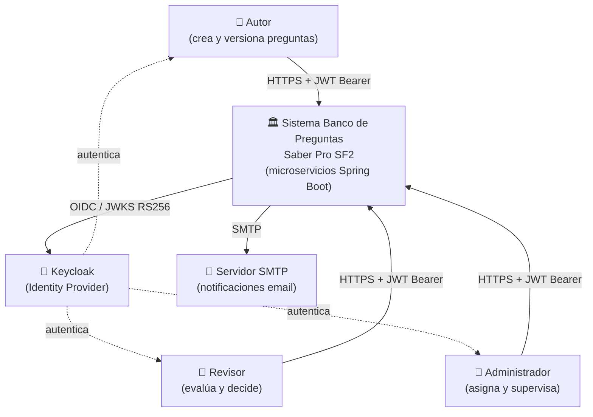
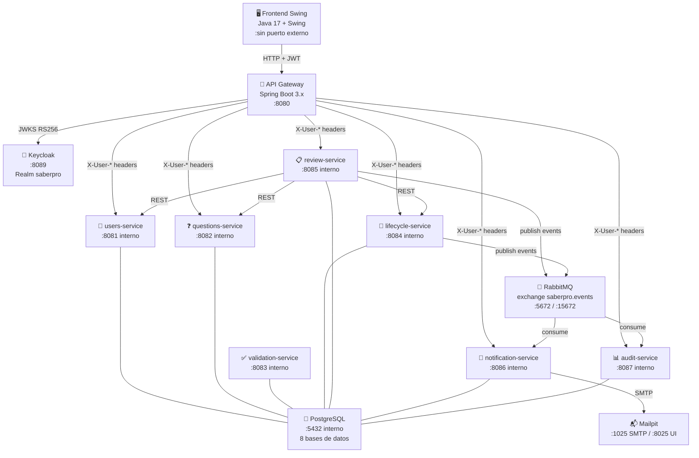
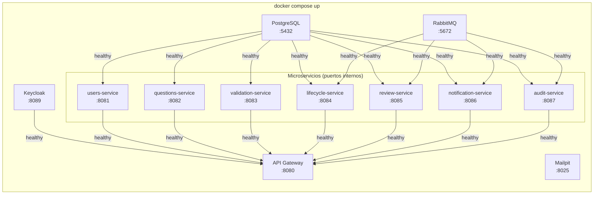

# Documento de Arquitectura — Banco de Preguntas Saber Pro (Sprint 3)

> **Proyecto:** Sistema Distribuido de Banco de Preguntas Saber Pro  
> **Versión:** 2.0.0 (Sprint 3 — Seguridad y Arquitectura Limpia)  
> **Fecha:** Noviembre 2026  
> **Autores:** Equipo SF2 — Universidad del Cauca  
> **Repositorio:** https://github.com/cristiang00/banco_preguntas_sf2  

---

## 1. Introducción

### 1.1 Propósito

Este documento describe la arquitectura del Sistema Distribuido de Banco de Preguntas Saber Pro desarrollado durante los Sprints 1, 2 y 3 de la asignatura Ingeniería de Software II. El sistema gestiona el ciclo de vida completo de las preguntas del examen Saber Pro de la Universidad del Cauca: creación, validación, revisión por pares, aprobación/rechazo y notificación.

### 1.2 Alcance

El Sprint 3 consolidó la arquitectura con:

- **HU6:** Historial de revisiones y versión mejorada (patrón State)
- **HU7:** Autenticación y autorización centralizada con Keycloak + JWT RS256
- **HU8:** Arquitectura hexagonal en el microservicio de Revisión
- **HU9:** Dockerización completa con Docker Compose y healthchecks
- **HU10:** Suite de pruebas unitarias automatizadas y pipeline CI/CD
- **HU11:** Documento de arquitectura y README actualizado
- **HU12:** Integración de correo SMTP real, filtros en BD y mensajería RabbitMQ

### 1.3 Historias de Usuario (HU1–HU12)

| HU | Título | Sprint | Pts |
|----|--------|--------|-----|
| HU1 | Creación de Pregunta con Patrón Builder y Validación | 1 | 8 |
| HU2 | Ciclo de Vida de la Pregunta con Patrón State | 1 | 8 |
| HU3 | Listado y Gestión de Preguntas con Patrón Facade | 1 | 5 |
| HU4 | Asignación de Revisores (Administrador) | 2 | 8 |
| HU5 | Revisión y Decisión por Revisores | 2 | 8 |
| HU6 | Historial de Revisiones y Versión Mejorada | 3 | 8 |
| HU7 | Autenticación y Autorización con Keycloak + JWT | 3 | 8 |
| HU8 | Arquitectura Hexagonal en Revisión | 3 | 8 |
| HU9 | Dockerización Completa con Docker Compose | 3 | 5 |
| HU10 | Pruebas Unitarias Automatizadas y Pipeline CI | 3 | 5 |
| HU11 | Documento de Arquitectura PDF y README | 3 | 5 |
| HU12 | Pendientes Sprint 2 (SMTP, filtros BD, RabbitMQ) | 3 | 5 |

---

## 2. Diagramas C4

### 2.1 Nivel 1 — Contexto del Sistema



### 2.2 Nivel 2 — Contenedores



### 2.3 Nivel 3 — Componentes del API Gateway

```mermaid
flowchart TD
    client["Cliente HTTP\n(Frontend / Postman)"]
    cors["CorsConfig\nPolítica CORS"]
    corrFilter["CorrelationFilter\nX-Correlation-Id"]
    router["GatewayRoutingController\nEnrutamiento y propagación\nX-User-* headers"]
    jwtval["JwtValidator\nRS256 JWKS + HS256 fallback\nkeyLocator cache"]
    openapi["OpenApiConfig\nSwagger UI + Bearer scheme"]
    props["GatewayProperties\nURLs de microservicios"]

    client -->|"HTTP Request"| cors
    cors --> corrFilter
    corrFilter --> router
    router -->|"verifica token"| jwtval
    jwtval -->|"JWKS"| kc["Keycloak :8089"]
    router -->|"envía a backend"| backend["Microservicio destino"]
    openapi -.->|"documenta"| router
    props -.->|"configura rutas"| router
```



### 2.4 Nivel 3 — Componentes del review-service (Arquitectura Hexagonal)

```mermaid
flowchart TD
    subgraph domain["Dominio (Java puro)"]
        rev["RevisionEntity\nEvaluacionRevisorEntity\nObservacionEntity"]
        policy["PoliticaConsensoRevision\nReglas de negocio puras"]
    end

    subgraph application["Aplicación (Casos de Uso)"]
        asignar["AsignarRevisoresUseCase"]
        evaluar["EvaluarPreguntaUseCase"]
        decidir["DecidirRevisionUseCase"]
        historial["ConsultarHistorialUseCase"]
        listar["ListarRevisionesUseCase"]
    end

    subgraph ports["Puertos (Interfaces)"]
        repoPort["RevisionRepositoryPort"]
        questPort["QuestionsServicePort"]
        lifecyclePort["LifecycleServicePort"]
        usersPort["UsersServicePort"]
        eventPort["EventPublisherPort"]
    end

    subgraph infra["Infraestructura (Adaptadores)"]
        jpaAdapter["JpaRevisionRepositoryAdapter\n(Spring Data JPA)"]
        questClient["QuestionsClientAdapter\n(RestTemplate)"]
        lifecycleClient["LifecycleClientAdapter\n(RestTemplate)"]
        usersClient["UsuariosClientAdapter\n(RestTemplate)"]
        rabbitAdapter["ReviewEventPublisherAdapter\n(RabbitMQ + fallback HTTP)"]
        controller["ReviewController\n(Spring MVC)"]
        inMemory["InMemoryRevisionRepositoryAdapter\n(Tests)"]
    end

    controller --> asignar
    controller --> evaluar
    controller --> decidir
    controller --> historial
    asignar --> repoPort
    asignar --> questPort
    asignar --> usersPort
    asignar --> eventPort
    evaluar --> repoPort
    decidir --> repoPort
    decidir --> lifecyclePort
    decidir --> eventPort
    decidir --> policy
    historial --> repoPort
    historial --> questPort
    repoPort -.->|"implementa"| jpaAdapter
    repoPort -.->|"implementa"| inMemory
    questPort -.->|"implementa"| questClient
    lifecyclePort -.->|"implementa"| lifecycleClient
    usersPort -.->|"implementa"| usersClient
    eventPort -.->|"implementa"| rabbitAdapter
```



---

## 3. Decisiones de Arquitectura

### 3.1 ADR-01: RabbitMQ como bus de eventos (HU12.S3.1)

**Contexto:** El review-service y el lifecycle-service deben notificar a notification-service y audit-service cuando ocurren eventos de dominio (`PreguntaAprobada`, `PreguntaRechazada`, `RevisoresAsignados`).

**Opciones evaluadas:**

| Criterio | Opción A: RabbitMQ | Opción B: HTTP REST síncrono |
|----------|-------------------|------------------------------|
| Desacoplamiento | ✅ Alto (publicador no espera) | ❌ Bajo (acoplamiento temporal) |
| Fiabilidad | ✅ Cola persistente, TTL, DLQ | ❌ Fallo en receptor rompe flujo |
| Complejidad | ⚠️ Broker adicional | ✅ Sin infraestructura extra |
| Trazabilidad | ✅ X-Correlation-Id en headers | ⚠️ Requiere propagación manual |

**Decisión:** **Opción A — RabbitMQ** con exchange `saberpro.events` y fallback HTTP automático en `ReviewEventPublisher` y `LifecycleEventPublisher`. Si el broker no está disponible, el sistema cae a HTTP REST para no interrumpir el flujo de revisión.

**Consecuencias:** notification-service y audit-service son consumidores independientes; una caída de cualquiera no afecta al publicador.

### 3.2 ADR-02: Keycloak con RS256 y fallback HS256 (HU7)

**Decisión:** El `JwtValidator` del api-gateway valida tokens RS256 descargando la clave pública del endpoint JWKS de Keycloak (`/realms/saberpro/protocol/openid-connect/certs`). Si Keycloak no está disponible en startup, cae a validación HS256 con clave simétrica para no bloquear el arranque en desarrollo.

**Anti-suplantación:** El gateway filtra activamente las cabeceras `X-User-Id`, `X-User-Role` y `X-User-Name` recibidas del cliente antes de sobrescribirlas con los valores extraídos del token verificado.

---

## 4. Escenarios de Calidad

### 4.1 Escenario de Modificabilidad — HU8 Arquitectura Hexagonal

| Componente | Detalle |
|-----------|---------|
| **Contexto** | El review-service almacena revisiones en PostgreSQL mediante JPA |
| **Estímulo** | Se decide migrar el repositorio de revisiones de PostgreSQL a MongoDB |
| **Fuente** | Decisión técnica del equipo de desarrollo |
| **Respuesta** | Solo se crea un nuevo adaptador `MongoRevisionRepositoryAdapter` que implementa `RevisionRepositoryPort`; el dominio y los casos de uso no se modifican |
| **Medición** | 0 líneas modificadas en `domain/` y `application/`; solo se agrega el adaptador en `infrastructure/` |
| **Resultado esperado** | Cambio de BD sin regresión: todos los tests de dominio y casos de uso pasan sin modificación |

**Evidencia:** `InMemoryRevisionRepositoryAdapter` demuestra este principio — los `ReviewHexagonalUseCaseTest` corren con repositorio en memoria sin tocar el dominio.

### 4.2 Escenario de Seguridad — HU7 Autenticación JWT

| Componente | Detalle |
|-----------|---------|
| **Contexto** | Sistema en producción con usuarios autenticados vía Keycloak |
| **Estímulo** | Un cliente malicioso envía una solicitud con cabecera `X-User-Id: 1` (impersonando al administrador) sin token válido |
| **Fuente** | Actor externo malicioso |
| **Respuesta** | El `GatewayRoutingController` filtra la cabecera `X-User-Id` recibida; solo propaga el valor extraído del JWT verificado con la clave pública RSA de Keycloak |
| **Medición** | 401 Unauthorized si no hay token; 403 si el rol no tiene permiso; la cabecera inyectada es completamente ignorada |
| **Resultado esperado** | 0 bypass de identidad posibles; evidenciado por `GatewaySecurityAndRoutingTest.tokenValido_xUserIdDelClienteEsIgnorado()` |

### 4.3 Escenario de Escalabilidad — HU9 Docker Compose

| Componente | Detalle |
|-----------|---------|
| **Contexto** | Pico de carga en temporada de evaluaciones Saber Pro |
| **Estímulo** | 500 usuarios concurrentes enviando preguntas a revisión |
| **Fuente** | Incremento estacional de usuarios |
| **Respuesta** | Se escalan réplicas de `review-service` con `docker compose up --scale review-service=3`; el gateway distribuye la carga; RabbitMQ absorbe picos de eventos |
| **Medición** | Tiempo de respuesta P95 < 2s con 3 réplicas; medición con `load-test.ps1` |
| **Resultado esperado** | Sistema operativo sin degradación de funcionalidad ni pérdida de datos |

---

## 5. Catálogo de Patrones de Diseño

### 5.1 Patrones GoF Aplicados

| Patrón | Categoría | Dónde se usa | HU |
|--------|-----------|--------------|-----|
| **Builder** | Creacional | `PreguntaBuilder` construye `PreguntaEntity` con validaciones encadenadas | HU1 |
| **Facade** | Estructural | `QuestionQueryFacade` unifica consulta de preguntas + estado del ciclo de vida | HU3 |
| **State** | Comportamiento | `DraftState`, `PendingReviewState`, `ApprovedState`, `RejectedState` + `QuestionStateFactory` | HU2, HU6 |
| **Observer** | Comportamiento | `DomainEventBus` + `DomainObserver` notifican a Notificaciones y Auditoría | HU2 |
| **Factory Method** | Creacional | `RevisionNotificacionFactory` crea el tipo correcto de notificación según el evento | HU6 |
| **Adapter** | Estructural | `SmtpEmailAdapter` adapta `JavaMailSender` a la interfaz `EmailPort` | HU12 |
| **Port/Adapter** (Hexagonal) | Arquitectural | Todo el review-service: puertos de entrada (use cases) y puertos de salida (repositorio, servicios REST, eventos) | HU8 |

### 5.2 Decisión de Patrón State vs. If-Else (HU2 / HU6)

**Problema:** La lógica de transición de estados de las preguntas (Borrador → Pendiente → Aprobada / Rechazada → Borrador) podría implementarse con cadenas de `if-else`.

**Solución con State:** Cada estado encapsula sus propias reglas de transición. Añadir un nuevo estado (ej. `EnRevisionSecundaria`) requiere una nueva clase que implementa `QuestionState`, sin modificar las clases existentes — cumple el **Principio Abierto/Cerrado (OCP)**.

**Evidencia de modificabilidad:** La transición `Rechazada → Borrador` para "crear versión mejorada" (HU6) se añadió creando `RejectedState.createNewVersion()` sin tocar `DraftState`, `ApprovedState` ni `PendingReviewState`.

---

## 6. Infraestructura y Despliegue

### 6.1 Docker Compose — Topología de Servicios



### 6.2 Volúmenes Persistentes

| Volumen | Contenido |
|---------|-----------|
| `postgres-data` | Bases de datos de todos los microservicios |
| `keycloak-data` | Realm, usuarios y configuración de Keycloak |

### 6.3 Healthchecks

Todos los microservicios exponen `/actuator/health` vía `spring-boot-starter-actuator`. El compose configura `condition: service_healthy` en cascada para garantizar el orden de arranque:

```
PostgreSQL → Keycloak + RabbitMQ → Microservicios → API Gateway
```

---

## 7. Decisión RabbitMQ — Justificación (HU12.S3.3)

La elección de RabbitMQ como bus de mensajería sobre HTTP REST directo responde a tres criterios:

1. **Desacoplamiento temporal:** `review-service` publica el evento `PreguntaAprobada` y retorna al cliente inmediatamente; `notification-service` y `audit-service` procesan en background.
2. **Resiliencia:** Si `notification-service` está caído, el mensaje queda en la cola y se procesa al reiniciar. Con HTTP síncrono, el evento se perdería.
3. **Extensibilidad:** Añadir un nuevo consumidor (ej. `analytics-service`) no requiere modificar los publicadores — cumple OCP.

**Manejo de contingencia:** `ReviewEventPublisher` y `LifecycleEventPublisher` capturan `AmqpException` y hacen fallback a HTTP REST directo (`notificationClient.notificar(...)`), garantizando que el flujo de revisión nunca se interrumpe por indisponibilidad del broker.

---

## 8. Pipeline CI/CD (HU10.S4)

El archivo `.github/workflows/ci.yml` define el pipeline:

```
Push / PR → Checkout → Java 17 (Temurin) → mvn test (12 módulos) → Reporte Surefire
```

**Badge de estado:**

```markdown
[](https://github.com/cristiang00/banco_preguntas_sf2/actions/workflows/ci.yml)
```

---

## 9. Evidencias Manuales Pendientes

> [!IMPORTANT]
> Las siguientes evidencias requieren ejecución en la máquina con Docker Desktop y acceso a Jira. No pueden generarse por código.

| # | Acción | HU |
|---|--------|-----|
| 1 | Capturar tablero Jira: Sprints 1, 2 y 3 (backlog + board) | HU11.S1.3 |
| 2 | `docker compose up --build` → capturar todos los servicios `healthy` | HU9.S1.4 |
| 3 | `docker volume ls` mostrando `saberpro_postgres-data` y `saberpro_keycloak-data` | HU9.S2.3 |
| 4 | POST a Keycloak para obtener JWT de `autor1`, `revisor1`, `admin` | HU7.S1.4 |
| 5 | GET al Gateway con Bearer token → 200 OK; sin token → 401 | HU7.S2.1 |
| 6 | Conexión directa a puerto interno → rechazada (no expuesta) | HU7.S5.3 |
| 7 | Registrar orden de arranque estable en 3 ciclos de `docker compose up/down` | HU9.S3.3 |

