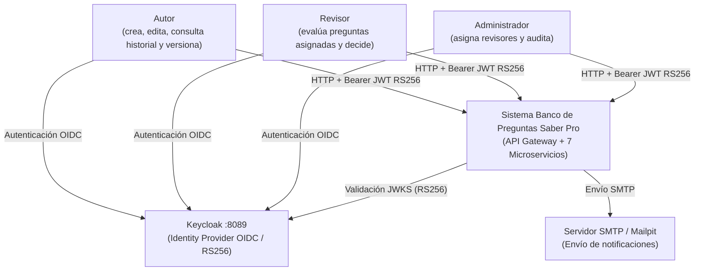
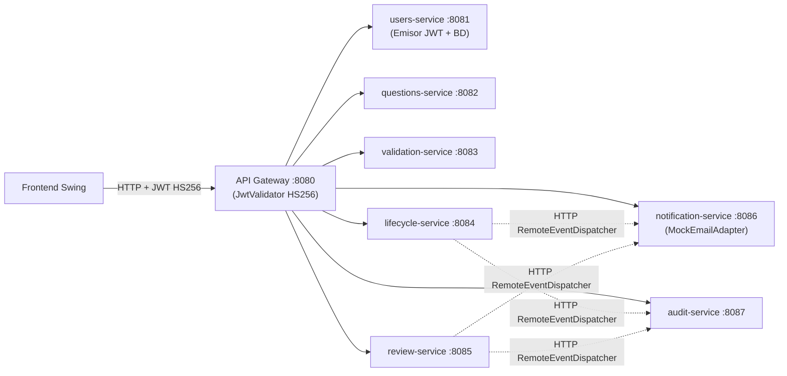
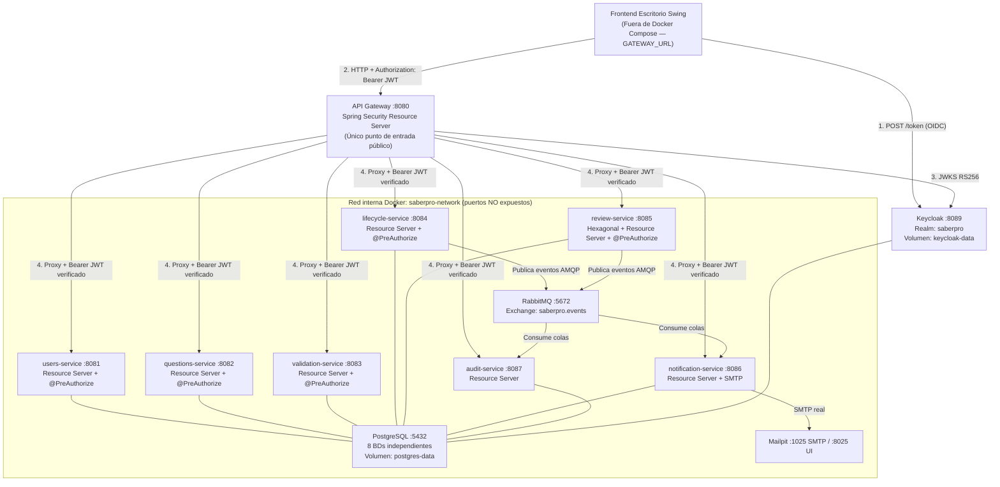
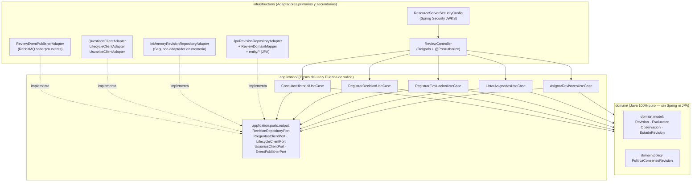

# Documento de Arquitectura — Banco de Preguntas Saber Pro (Sprint 3)

> **Proyecto:** Sistema Distribuido de Banco de Preguntas Saber Pro  
> **Asignatura:** Ingeniería de Software II — Universidad del Cauca  
> **Versión:** 2.0.0 (Sprint 3 — Seguridad y Arquitectura Limpia)  
> **Fecha:** Noviembre 2026  
> **Autores:** Equipo SF2 — Universidad del Cauca  
> **Repositorio Git:** https://github.com/cristiang00/banco_preguntas_sf2

---

## 1. Introducción

### 1.1 Propósito y alcance

Este documento describe la arquitectura del **Sistema Distribuido de Banco de Preguntas Saber Pro** desarrollado a lo largo de las iteraciones 1, 2 y 3 del curso Ingeniería de Software II. El sistema gestiona el ciclo de vida completo de las preguntas de selección múltiple con única respuesta alineadas al Diseño Centrado en Evidencia: creación, validación estructural extensible, ciclo de vida con máquina de estados, asignación y revisión por pares, versionado de preguntas rechazadas, notificaciones por correo SMTP real, auditoría orientada a eventos y seguridad centralizada con Keycloak OIDC/JWT.

En la **Iteración 3 (Sprint 3 — Seguridad y Arquitectura Limpia)** se consolidaron:
- **HU6:** Historial de revisiones agrupado por ronda (evaluaciones y observaciones) y creación de versiones mejoradas conservando las versiones anteriores.
- **HU7:** Autenticación y autorización con **Keycloak** y **Spring Security OAuth2 Resource Server** (JWKS RS256) en el API Gateway y en cada microservicio (`@PreAuthorize`), retirando el emisor JWT propio de `users-service` y bloqueando accesos directos sin token verificado.
- **HU8:** Arquitectura limpia (hexagonal) en `review-service` con dominio Java puro (sin Spring ni JPA), puertos y dos adaptadores intercambiables (`JpaRevisionRepositoryAdapter` e `InMemoryRevisionRepositoryAdapter`).
- **HU9:** Dockerización completa con Dockerfiles multi-stage, volúmenes persistentes (`postgres-data`, `keycloak-data`), healthchecks (`/actuator/health`) y `depends_on: condition: service_healthy`.
- **HU10:** Suite de pruebas unitarias automatizadas del dominio y seguridad en todos los módulos más pipeline CI en GitHub Actions.
- **HU11:** Consolidación del documento de arquitectura en PDF, diagramas C4 de Iteraciones 2 y 3, escenarios de calidad y README raíz.
- **HU12:** Cierre de pendientes del Sprint 2: envío SMTP real (`SmtpEmailAdapter` + Mailpit), correo del autor consultado a `users-service`, filtro `estado` en consulta JPQL antes de paginar y mensajería asíncrona con RabbitMQ (`saberpro.events`).

---

## 2. Historias de Usuario y Criterios de Aceptación (HU1 a HU12)

### 2.1 Iteraciones 1 y 2 (HU1 a HU5)

| HU | Historia de Usuario | Criterios de Aceptación Consolidados |
|---|---|---|
| **HU1** | Como **AUTOR** necesito crear preguntas de selección múltiple con única respuesta bajo el Diseño Centrado en Evidencia para alimentar el banco Saber Pro. | • Debe incluir: contexto, pregunta directa, 4 opciones (A–D), respuesta correcta única, justificación, bibliografía, competencia, tema, subtema y nivel de dificultad (`Bajo`, `Medio`, `Alto`).<br>• Al grabar, `validation-service` ejecuta todas las reglas estructurales (`ReglaCamposObligatorios`, `ReglaRespuestaCorrecta`, `ReglaDificultad`, `ReglaBibliografia`, `ReglaCatalogos`).<br>• Si es válida, se construye con `PreguntaBuilder` y se persiste en estado `BORRADOR` (v1); si falla, retorna HTTP `400` con la lista de errores por campo. |
| **HU2** | Como **AUTOR** necesito cambiar el estado de mis preguntas de `BORRADOR` a `PENDIENTE_REVISION` para que el administrador les asigne revisores. | • Solo el autor propietario puede enviar su pregunta (`403` en caso contrario).<br>• Solo se permite desde `BORRADOR` usando el patrón State (`409` desde otro estado).<br>• Cada estado tiene etiqueta y color distintivo (`BORRADOR`, `PENDIENTE_REVISION`, `APROBADA`, `RECHAZADA`).<br>• Se registra la transición en `historial_transiciones` y se publica `PreguntaEnviadaARevisionEvent` en el broker. |
| **HU3** | Como **AUTOR** necesito listar las preguntas que he creado para poder verlas y editarlas con paginación y filtros. | • El autor lista únicamente sus preguntas; el administrador puede ver todas.<br>• Soporta filtros combinados por estado(s) y dificultad con paginación real.<br>• `QuestionQueryFacade` integra el estado autoritativo y calcula `accionesPermitidas`.<br>• Solo se permite editar (`PUT /preguntas/{id}`) cuando el estado es `BORRADOR` (`409` en otro estado). |
| **HU4** | Como **ADMINISTRADOR** necesito asignar entre 1 y 3 revisores a preguntas en `PENDIENTE_REVISION` para que sean evaluadas por pares. | • Exclusivo para rol `ADMINISTRADOR` (`403` para otros roles).<br>• Exige entre 1 y 3 revisores activos con rol `REVISOR` (`400` si 0 o >3).<br>• Impide asignar al autor como revisor de su propia pregunta (`400`).<br>• Solo aplicable a preguntas en `PENDIENTE_REVISION` (`409` en otro estado).<br>• Publica `RevisoresAsignadosEvent` y notifica por correo a cada revisor asignado. |
| **HU5** | Como **REVISOR** necesito listar mis preguntas asignadas para evaluarlas, dejar observaciones y decidir `APROBADA` o `RECHAZADA`. | • Exclusivo para rol `REVISOR`; solo puede evaluar/decidir preguntas que le fueron asignadas (`403` en caso contrario) y no finalizadas (`409`).<br>• Al rechazar exige al menos una observación no vacía (`400`), rechaza la pregunta, cierra las demás revisiones pendientes y emite `PreguntaRechazadaEvent`.<br>• Al aprobar, la pregunta pasa a `APROBADA` únicamente por consenso unánime de todos los revisores asignados y emite `PreguntaAprobadaEvent`. |

### 2.2 Iteración 3 — Sprint 3: Seguridad y Arquitectura Limpia (HU6 a HU12)

| HU | Historia de Usuario | Criterios de Aceptación Consolidados |
|---|---|---|
| **HU6** (8 pts) | Como **AUTOR** necesito listar y ver el historial de revisiones y sus observaciones para sacar una versión mejorada y cambiar de estado. | • **S1:** `GET /revisiones/pregunta/{id}/historial` paginado agrupando cada ronda con revisor, decisión, fecha, evaluaciones y observaciones; visible en tabla con colores y panel de detalle en el frontend.<br>• **S2:** Validación estricta de autoría consultando `questions-service`; devuelve `403` con mensaje claro en API y frontend.<br>• **S3:** Transición `RECHAZADA -> BORRADOR` en patrón State (`RejectedState`), registro en historial de transiciones, `PUT /preguntas/{id}/nueva-version` aplicando validación estructural HU1, incremento de `version` y conservación inmutable de versiones previas en `pregunta_versiones`.<br>• **S4:** Rechazo `409` desde cualquier estado distinto a `RECHAZADA`; botón *"Crear versión mejorada"* deshabilitado/oculto fuera de `RECHAZADA`.<br>• **S5:** Reutiliza `PUT /preguntas/{id}/enviar-revision` publicando `PreguntaEnviadaARevisionEvent` con `version` y notificando al administrador y revisores de rondas anteriores. |
| **HU7** (8 pts) | Como **EQUIPO DE DESARROLLO** necesito autenticar y autorizar con Keycloak y JWT para proteger el acceso a los microservicios. | • **S1:** Keycloak en `docker-compose.yml` con `keycloak_db`, volumen `keycloak-data` e importación automática de `saberpro-realm.json` (roles `AUTOR`, `REVISOR`, `ADMINISTRADOR` y usuarios de prueba); guía Postman Admin REST API documentada.<br>• **S2:** Frontend obtiene JWT desde el endpoint de token de Keycloak (`401` si credenciales inválidas); login propio y emisor JWT retirados de `users-service`.<br>• **S3:** Spring Security OAuth2 Resource Server validando RS256 contra JWKS de Keycloak (`401` sin token, expirado o firmado con otra clave); Bearer documentado en Swagger.<br>• **S4:** Matriz rol-endpoint aplicada en Gateway y en cada microservicio con `@PreAuthorize` (`403` con mensaje claro y documentado en Swagger).<br>• **S5:** Puertos 8081–8087 sin publicar en `docker-compose.yml`; microservicios ignoran cabeceras `X-User-*` sin JWT verificado y no usan valores por defecto. |
| **HU8** (8 pts) | Como **EQUIPO DE DESARROLLO** necesito aplicar arquitectura limpia (hexagonal) en `review-service` para facilitar la modificabilidad del dominio. | • **S1:** Paquete `review.domain` 100% Java puro (`Revision`, `Evaluacion`, `Observacion`, `PoliticaConsensoRevision`) sin dependencias de Spring ni JPA; paquetes `application` (5 casos de uso) e `infrastructure` (adaptadores JPA/InMemory/REST/Security).<br>• **S2:** Puertos de salida (`RevisionRepositoryPort`, `PreguntasClientPort`, `LifecycleClientPort`, `UsuariosClientPort`, `EventPublisherPort`), mappers JPA↔dominio y `ReviewController` delgado.<br>• **S3:** Adaptador `InMemoryRevisionRepositoryAdapter` como segunda implementación del puerto; casos de uso verificados con ambos adaptadores sin modificar el dominio; escenario de modificabilidad redactado.<br>• **S4:** Pruebas unitarias puras del dominio y de casos de uso sin levantar contexto Spring. |
| **HU9** (5 pts) | Como **EQUIPO DE DESARROLLO** necesito dockerizar todo el sistema con Docker Compose y volúmenes para desplegarlo con un solo comando. | • **S1:** Dockerfiles multi-stage (Maven + JRE 17) con contexto en raíz compilando `contracts`, `.dockerignore` y `.env.example` actualizado.<br>• **S2:** Volúmenes `postgres-data` y `keycloak-data`; 8 bases de datos independientes en `docker/init-db.sql`.<br>• **S3:** Healthchecks `/actuator/health` en los 7 microservicios, Gateway y Keycloak; `depends_on` con `condition: service_healthy`.<br>• **S4:** Frontend Swing fuera de Compose conectado al Gateway mediante variable de entorno `GATEWAY_URL`, documentado en README. |
| **HU10** (5 pts) | Como **EQUIPO DE DESARROLLO** necesito pruebas unitarias automatizadas de las clases de dominio para garantizar la calidad. | • **S1:** Pruebas de `PreguntaEntity`, `OpcionEntity`, `PreguntaBuilder`, `QuestionService`, `QuestionQueryFacade`, todas las reglas de validación y `ValidationEngine`.<br>• **S2:** Pruebas de todos los estados, `QuestionStateFactory`, `LifecycleService` (incluyendo HU6) y reglas de Revisión.<br>• **S3:** Pruebas de `UsuarioService` y roles Keycloak, `NotificacionService` + fábricas + `SmtpEmailAdapter`, `AuditService` + `AuditObserver`, y seguridad/autorización del Gateway y microservicios.<br>• **S4 (opcional):** Workflow GitHub Actions `.github/workflows/ci.yml` con Java 17 y badge en `README.md`. |
| **HU11** (5 pts) | Como **EQUIPO DE DESARROLLO** necesito documentar la arquitectura en PDF y un README claro en la raíz. | • **S1:** Portada, introducción, consolidado HU1–HU12 con criterios de aceptación y sección de pantallazos Jira Sprints 1, 2 y 3.<br>• **S2:** Escenarios de modificabilidad y escalabilidad en tablas de 5 partes.<br>• **S3:** Diagramas C4 de Iteraciones 2 y 3 con seguridad JWT/Keycloak, sección Docker, catálogo de patrones y URL del repositorio Git.<br>• **S4:** `README.md` raíz completo, repositorio ordenado y `.gitignore` excluyendo `target/`, BD locales y `.env`. |
| **HU12** (5 pts) | Como **EQUIPO DE DESARROLLO** necesito cerrar pendientes del Sprint 2 (correo real, filtro por estado y mensajería). | • **S1:** Envío SMTP real con `JavaMailSender` en `SmtpEmailAdapter` + Mailpit, correo del autor consultado en `users-service`, `NOTIFICATION_EMAIL_PROVIDER=smtp` y tolerancia a fallos.<br>• **S2:** Parámetro `estado` en `GET /revisiones/asignadas`, filtros aplicados en JPQL antes de paginar (`RevisionRepository.findByRevisorIdWithFilters`), Swagger y panel Swing.<br>• **S3:** Opción A (RabbitMQ) adoptada y documentada en ADR-01: publicación en exchange `saberpro.events`, listeners `NotificationRabbitListener` y `AuditRabbitListener` + pruebas con broker simulado. |

### 2.3 Planificación de Sprints en Jira (Sprints 1, 2 y 3)

> *[Espacio para insertar los pantallazos exportados del tablero Scrum de Jira: Sprint 1 (HU1–HU3), Sprint 2 (HU4–HU5) y Sprint 3 (HU6–HU12). Ver Sección 9].*

---

## 3. Escenarios de Calidad

### 3.1 Escenario de Modificabilidad — HU8 Arquitectura Hexagonal

| Elemento | Descripción |
|---|---|
| **Contexto** | El microservicio `review-service` persiste revisiones, evaluaciones y observaciones en PostgreSQL mediante Spring Data JPA. |
| **Estímulo** | El equipo decide reemplazar el mecanismo de persistencia (por ejemplo, cambiar de PostgreSQL/JPA a un repositorio en memoria o NoSQL) o el mecanismo de mensajería. |
| **Respuesta** | Se implementa un nuevo adaptador secundario (`InMemoryRevisionRepositoryAdapter` o un futuro adaptador NoSQL) que implementa la interfaz `RevisionRepositoryPort` en `infrastructure/persistence/`, y se inyecta en `ReviewUseCaseConfig`. |
| **Medición** | **0 líneas modificadas** en `review/domain/` y `review/application/`; **0 imports** de Spring o `jakarta.persistence` en el paquete `review/domain/`. |
| **Resultado esperado** | Todos los casos de uso (`AsignarRevisoresUseCase`, `ListarAsignadasUseCase`, `RegistrarEvaluacionUseCase`, `RegistrarDecisionUseCase`, `ConsultarHistorialUseCase`) ejecutan idénticamente con ambos adaptadores (`JpaRevisionRepositoryAdapter` e `InMemoryRevisionRepositoryAdapter`) pasando el 100% de las pruebas automatizadas sin tocar el dominio (`ReviewHexagonalUseCaseTest.testIntercambiabilidadAdaptadoresSinModificarDominio`). |

### 3.2 Escenario de Escalabilidad — Microservicio de Revisión y Mensajería Asíncrona

| Elemento | Descripción |
|---|---|
| **Contexto** | Pico de demanda durante la jornada de cierre de banco de preguntas Saber Pro, con múltiples autores enviando preguntas y revisores evaluando concurrentemente. |
| **Estímulo** | Incremento de carga a 500 solicitudes concurrentes sobre consultas y decisiones de revisión, ejecutando `load-test.ps1` contra el API Gateway. |
| **Respuesta** | Se escala horizontalmente únicamente el microservicio cuello de botella (`docker compose up --scale review-service=3`) sin escalar los demás servicios; RabbitMQ absorbe el pico de eventos en el exchange `saberpro.events` desacoplando `notification-service` y `audit-service`. |
| **Medición** | Latencia P95 < 2000 ms, tasa de error 0% en transacciones válidas y 0 pérdida de eventos de notificación/auditoría (medible ejecutando `load-test.ps1` con Docker Compose activo). |
| **Resultado esperado** | El sistema mantiene la disponibilidad y el throughput esperado durante el pico sin bloquear el flujo de evaluación ni degradar otros contextos delimitados. |

### 3.3 Escenario de Seguridad — HU7 Keycloak + Spring Security Resource Server

| Elemento | Descripción |
|---|---|
| **Contexto** | El sistema opera en red con Keycloak emitiendo JWT RS256 y todos los servicios configurados como OAuth2 Resource Servers. |
| **Estímulo** | Un actor malicioso intenta: (a) llamar sin token o con token expirado/alterado, (b) falsificar cabeceras `X-User-Id: 1` y `X-User-Role: ADMINISTRADOR` directamente contra un microservicio o vía Gateway, o (c) invocar un endpoint fuera de su rol. |
| **Respuesta** | El Gateway y cada microservicio validan criptográficamente el JWT contra el JWKS de Keycloak, descartan cabeceras `X-User-*` no verificadas y aplican `@PreAuthorize` según los roles del claim `realm_access.roles`. |
| **Medición** | 100% de peticiones sin token o con JWT expirado/inválido rechazadas con HTTP `401`; 100% de violaciones de rol rechazadas con HTTP `403`; 0 puertos internos (8081–8087) publicados en Docker Compose. |
| **Resultado esperado** | 0 suplantaciones de identidad ni escalamiento de privilegios, verificado en `GatewaySecurityAndRoutingTest` y `ReviewSecurityAuthorizationTest`. |

---

## 4. Arquitectura y Diseño de Software — Modelo C4 (Iteraciones 2 y 3)

### 4.1 Evolución Iteración 2 → Iteración 3 (Resumen Comparativo)

| Dimensión | Iteración 2 (Sprint 2) | Iteración 3 (Sprint 3) |
|---|---|---|
| **Autenticación** | `users-service` emitía JWT simétrico HS256 (`/auth/login`) con secreto compartido. | **Keycloak** (`saberpro` realm) emite JWT asimétrico **RS256**; login propio retirado de `users-service`. |
| **Autorización** | Comparación manual de cabeceras `X-User-*` con valores por defecto en controllers; puertos 8081–8087 expuestos. | **Spring Security OAuth2 Resource Server** (JWKS) en Gateway y en los 7 microservicios con **`@PreAuthorize`**; cabeceras `X-User-*` sin JWT ignoradas; puertos internos cerrados en Compose. |
| **Arquitectura interna** | Capas `controller → service → repository` con entidades JPA como dominio en todos los servicios. | **`review-service` refactorizado a Arquitectura Hexagonal** (`domain` puro + `application` casos de uso + `infrastructure` adaptadores JPA/InMemory/REST/Security). |
| **Mensajería y Correo** | Eventos despachados por HTTP (`RemoteEventDispatcher`) y correo simulado (`MockEmailAdapter`). | **RabbitMQ** (`saberpro.events`) con listeners AMQP + fallback HTTP autenticado, y **SMTP real** (`SmtpEmailAdapter` + Mailpit). |
| **Despliegue Docker** | Dockerfiles dependían de `target/*.jar` precompilado y carecían de healthchecks en servicios y Keycloak. | **Dockerfiles multi-stage** (Maven + JRE 17), `keycloak` + `keycloak-data`, healthchecks `/actuator/health` y `condition: service_healthy`. |

### 4.2 Nivel 1 — Diagrama de Contexto (Iteración 3)



### 4.3 Nivel 2 — Diagrama de Contenedores (Iteración 2 vs. Iteración 3)

#### Iteración 2 (Línea base)


#### Iteración 3 (Seguridad Keycloak/Resource Server, RabbitMQ y Red Interna Cerrada)


> **Nota sobre el Frontend Swing (HU9):** El cliente `frontend` es una aplicación de escritorio Java Swing (interfaz gráfica nativa) y por diseño queda **fuera de `docker-compose.yml`**. Se ejecuta localmente y se conecta al API Gateway mediante la variable de entorno `GATEWAY_URL` (por defecto `http://localhost:8080/api/v1`) y a Keycloak mediante `KEYCLOAK_TOKEN_URL` (`http://localhost:8089/realms/saberpro/protocol/openid-connect/token`).

### 4.4 Nivel 3 — Componentes de `review-service` (Arquitectura Hexagonal — HU8)



---

## 5. Catálogo de Patrones de Diseño Aplicados

| Patrón | Categoría | Implementación en el Proyecto | Contexto del Problema |
|---|---|---|---|
| **Builder** | Creacional | `PreguntaBuilder` (`questions-service`) | Construye paso a paso entidades `PreguntaEntity` complejas con 4 opciones, metadatos curriculares, estado inicial `BORRADOR` y versión inicial `1`, evitando constructores telescópicos. |
| **Factory Method** | Creacional | `NotificacionFactory` y subclases (`AsignacionNotificacionFactory`, `AprobacionNotificacionFactory`, `RechazoNotificacionFactory`, `RevisionNotificacionFactory`) + `NotificacionFactoryProvider` | Encapsula la creación de distintos tipos de correos electrónicos según el evento de dominio recibido sin acoplar `NotificacionService` a clases concretas. |
| **Facade** | Estructural | `QuestionQueryFacade` (`questions-service`) | Ofrece una interfaz unificada para listar preguntas paginadas/filtradas y consultar detalles, combinando datos locales con el estado autoritativo de `lifecycle-service` y calculando acciones permitidas. |
| **Adapter** | Estructural | `SmtpEmailAdapter` / `MockEmailAdapter` (`notification-service`); `JpaRevisionRepositoryAdapter`, `InMemoryRevisionRepositoryAdapter`, `QuestionsClientAdapter`, `LifecycleClientAdapter`, `UsuariosClientAdapter`, `ReviewEventPublisherAdapter` (`review-service`) | Adapta tecnologías concretas (`JavaMailSender`, Spring Data JPA, `RestTemplate`, `RabbitTemplate`) a interfaces de dominio/puertos, permitiendo intercambiar proveedores sin tocar lógica de negocio. |
| **State** | Comportamiento | `QuestionState`, `AbstractQuestionState`, `DraftState`, `PendingReviewState`, `ApprovedState`, `RejectedState`, `QuestionStateFactory` (`lifecycle-service`) | Encapsula las reglas de transición válidas por estado (`BORRADOR → PENDIENTE_REVISION → APROBADA/RECHAZADA → BORRADOR` en HU6), eliminando condicionales extensos y cumpliendo OCP. |
| **Observer** | Comportamiento | `DomainEventBus`, `DomainObserver`, `AuditObserver` (`contracts` / `audit-service`) + listeners AMQP (`NotificationRabbitListener`, `AuditRabbitListener`) | Desacopla a los productores de eventos (`lifecycle-service`, `review-service`) de los consumidores de notificaciones y auditoría. |
| **Strategy / Chain of Rules** | Comportamiento | `ReglaValidacion` y 5 implementaciones concretas ejecutadas por `ValidationEngine` (`validation-service`) | Permite agregar nuevas reglas de validación estructural de preguntas sin modificar el motor de validación. |
| **Hexagonal (Ports & Adapters)** | Arquitectural | `review-service` (`domain/`, `application/`, `infrastructure/`) | Aísla completamente las reglas de negocio de revisión (1–3 revisores, autor excluido, rechazo con observación, consenso unánime) de Spring, JPA y HTTP. |

---

## 6. Decisiones de Arquitectura (ADR)

### 6.1 ADR-01: RabbitMQ como bus de eventos (HU12.S3)

- **Decisión:** Adoptar **Opción A (RabbitMQ)** con Topic Exchange `saberpro.events` y colas dedicadas (`saberpro.notifications.queue` y `saberpro.audit.queue`) consumidas por `NotificationRabbitListener` y `AuditRabbitListener`.
- **Justificación:** Desacopla temporalmente los servicios productores de los consumidores, evita pérdida de notificaciones ante reinicios y permite incorporar nuevos consumidores sin modificar productores (OCP).
- **Contingencia:** Si RabbitMQ no está accesible temporalmente, `LifecycleEventPublisher` y `ReviewEventPublisher` capturan la excepción y realizan un fallback HTTP asíncrono (`RemoteEventDispatcher`) propagando el token Bearer verificado.

### 6.2 ADR-02: Keycloak OIDC + Spring Security OAuth2 Resource Server (HU7)

- **Decisión:** Retirar el login propio y el emisor JWT HS256 de `users-service`, delegando toda emisión de tokens a **Keycloak** (`RS256`). Tanto `api-gateway` como los 7 microservicios actúan como **Spring Security OAuth2 Resource Servers** validando firma y expiración contra el endpoint JWKS de Keycloak (`NimbusJwtDecoder.withJwkSetUri`), aplicando `@PreAuthorize` por rol e ignorando cualquier cabecera `X-User-*` sin token verificado.

---

## 7. Gestión de Usuarios y Roles en Keycloak vía Postman (Admin REST API — HU7.S1.3)

El realm `saberpro` se importa automáticamente al iniciar Docker Compose desde `docker/keycloak/saberpro-realm.json` con los roles `AUTOR`, `REVISOR`, `ADMINISTRADOR` y los usuarios `autor1`, `revisor1`, `revisor2` y `admin`. Para crear usuarios adicionales y asignar roles desde **Postman** usando la **Keycloak Admin REST API**:

1. **Obtener token de administrador de Keycloak (`master`):**
   - `POST http://localhost:8089/realms/master/protocol/openid-connect/token`
   - Body (`x-www-form-urlencoded`): `grant_type=password`, `client_id=admin-cli`, `username=admin`, `password=admin`
   - Copiar el campo `access_token` como `ADMIN_TOKEN`.
2. **Crear un usuario en el realm `saberpro`:**
   - `POST http://localhost:8089/admin/realms/saberpro/users`
   - Header: `Authorization: Bearer {{ADMIN_TOKEN}}`, `Content-Type: application/json`
   - Body:
     ```json
     {
       "username": "autor2",
       "email": "autor2@unicauca.edu.co",
       "firstName": "Laura",
       "lastName": "Gomez",
       "enabled": true,
       "emailVerified": true,
       "credentials": [
         { "type": "password", "value": "Autor1234!", "temporary": false }
       ]
     }
     ```
   - Obtener el `userId` del header `Location` de la respuesta `201 Created` (o con `GET /admin/realms/saberpro/users?username=autor2`).
3. **Consultar la representación del rol del realm (`AUTOR`, `REVISOR` o `ADMINISTRADOR`):**
   - `GET http://localhost:8089/admin/realms/saberpro/roles/AUTOR`
   - Header: `Authorization: Bearer {{ADMIN_TOKEN}}` → devuelve `{ "id": "<roleId>", "name": "AUTOR" }`.
4. **Asignar el rol al usuario:**
   - `POST http://localhost:8089/admin/realms/saberpro/users/{{USER_ID}}/role-mappings/realm`
   - Header: `Authorization: Bearer {{ADMIN_TOKEN}}`, `Content-Type: application/json`
   - Body: `[{ "id": "{{ROLE_ID}}", "name": "AUTOR" }]` → responde `204 No Content`.
5. **Obtener token JWT del nuevo usuario para consumir el API Gateway:**
   - `POST http://localhost:8089/realms/saberpro/protocol/openid-connect/token`
   - Body (`x-www-form-urlencoded`): `grant_type=password`, `client_id=gateway-client`, `client_secret=saberpro-client-secret-2026`, `username=autor2`, `password=Autor1234!`.

---

## 8. Dockerización, Volúmenes, Healthchecks y CI/CD (HU9 y HU10)

- **Builds multi-stage:** Todos los Dockerfiles (`api-gateway/Dockerfile` y `services/*/Dockerfile`) compilan `contracts` y el microservicio usando `maven:3.9-eclipse-temurin-17-alpine` y ejecutan únicamente el JAR empaquetado sobre `eclipse-temurin:17-jre-alpine`, permitiendo levantar todo desde un clon limpio con `docker compose up --build`.
- **Aislamiento de bases de datos y persistencia:** `docker/init-db.sql` inicializa 8 bases de datos independientes (`users_db`, `questions_db`, `validation_db`, `lifecycle_db`, `review_db`, `notification_db`, `audit_db`, `keycloak_db`) respaldadas por el volumen `postgres-data`, y Keycloak persiste su estado en `keycloak-data`.
- **Orden de arranque con healthchecks:** Todos los servicios exponen `/actuator/health` (Spring Boot Actuator) y `docker-compose.yml` encadena `depends_on` con `condition: service_healthy`:
  `PostgreSQL` → `Keycloak + RabbitMQ` → `7 Microservicios` → `API Gateway`.
- **Integración Continua (CI):** `.github/workflows/ci.yml` ejecuta `mvn test` con JDK 17 (Temurin) en cada `push` y `pull_request` hacia `main` y `develop`.

---

## 9. Evidencias Externas Requeridas (Entorno con Docker Desktop, Postman y Jira)

> Las siguientes capturas de pantalla dependen de herramientas externas del equipo (Docker Desktop, cuenta Jira y colección Postman) y deben anexarse en la entrega final:

| # | Evidencia a capturar | Subtarea |
|---|---|---|
| 1 | Pantallazos del tablero Jira de los Sprints 1, 2 y 3 | HU11.S1.3 |
| 2 | Terminal ejecutando `docker compose up --build` y `docker compose ps` mostrando todos los contenedores `healthy` | HU9.S1.4 / HU11.S3.2 |
| 3 | Prueba de persistencia (`crear pregunta` → `docker compose down` sin `-v` → `docker compose up -d` → pregunta conservada) + `docker volume ls` | HU9.S2.3 / HU11.S3.2 |
| 4 | Registro de orden de arranque estable tras reiniciar el stack varias veces | HU9.S3.3 |
| 5 | Pantallazos de Postman: obtención de token en Keycloak (`200` y `401`), consumo vía Gateway (`200`/`401`/`403`) y fallo de conexión directa a puertos internos | HU7.S1.4 / HU7.S2.1 / HU7.S5.3 |
| 6 | Resultado de medición de carga ejecutando `load-test.ps1` contra el stack en Docker | HU11.S2.2 |
