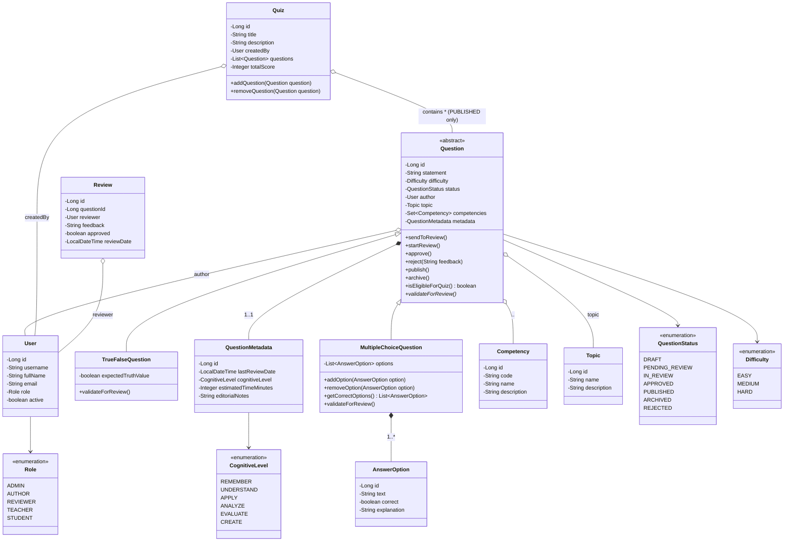

# Diseño de Arquitectura y Modelo de Dominio - Banco de Preguntas Saber Pro
## Taller 10: Persistencia Limpia con JPA y Spring Boot

---

### 1. Diagrama de Arquitectura en Capas

El sistema sigue una arquitectura por capas estricta con inversión de dependencias:
* **API (Presentación):** Expone endpoints REST y delega en los servicios de aplicación.
* **Application (Casos de Uso):** Orquesta los casos de uso del negocio (crear preguntas, clasificar, revisar, publicar y crear cuestionarios). Depende **únicamente** de las interfaces de repositorio del dominio.
* **Domain (Núcleo de Negocio):** Contiene las entidades puras y las interfaces abstractas de persistencia. **Libre de anotaciones JPA.**
* **Infrastructure (Persistencia JPA):** Implementa las interfaces de repositorio del dominio mediante Spring Data JPA, utilizando registros tecnológicos (`*Record`) y un mapeador bidireccional (`DomainMapper`).

```mermaid
graph TD
    subgraph Presentation_Layer [API / Presentation Layer]
        QC[QuestionController]
        ZC[QuizController]
    end

    subgraph Application_Layer [Application Service Layer]
        QS[QuestionService]
        RS[ReviewService]
        ZS[QuizService]
    end

    subgraph Domain_Layer [Domain Layer - Zero JPA Annotations]
        subgraph Domain_Repositories [Abstract Repository Contracts]
            QR[QuestionRepository]
            UR[UserRepository]
            CR[CompetencyRepository]
            TR[TopicRepository]
            ZR[QuizRepository]
            RR[ReviewRepository]
        end
        subgraph Domain_Model [Core Domain Entities]
            Q[Question - abstract]
            MC[MultipleChoiceQuestion]
            TF[TrueFalseQuestion]
            AO[AnswerOption]
            QM[QuestionMetadata]
            U[User]
            C[Competency]
            T[Topic]
            Z[Quiz]
            REV[Review]
            
            Q <|-- MC
            Q <|-- TF
            MC *-- AO
            Q *-- QM
            Q o-- U : author
            Q o-- T : topic
            Q }o--o{ C : competencies
            Z }o--o{ Q : published questions
        end
    end

    subgraph Infrastructure_Layer [Infrastructure Layer - JPA Persistence]
        QR_JPA[QuestionRepositoryJpa]
        UR_JPA[UserRepositoryJpa]
        CR_JPA[CompetencyRepositoryJpa]
        TR_JPA[TopicRepositoryJpa]
        ZR_JPA[QuizRepositoryJpa]
        DM[DomainMapper]
        
        subgraph Spring_Data_JPA [Spring Data JPA Interfaces]
            SQD[SpringQuestionDataRepository]
            SUD[SpringUserDataRepository]
            SCD[SpringCompetencyDataRepository]
            STD[SpringTopicDataRepository]
            SZD[SpringQuizDataRepository]
        end
        
        subgraph JPA_Records [JPA Records - Entities]
            QR_REC[QuestionRecord - JOINED]
            MC_REC[MultipleChoiceQuestionRecord]
            TF_REC[TrueFalseQuestionRecord]
            AO_REC[AnswerOptionRecord]
            QM_REC[QuestionMetadataRecord]
            U_REC[UserRecord]
            C_REC[CompetencyRecord]
            T_REC[TopicRecord]
            Z_REC[QuizRecord]
            
            QR_REC <|-- MC_REC
            QR_REC <|-- TF_REC
            MC_REC *-- AO_REC
            QR_REC *-- QM_REC
            QR_REC o-- U_REC
            QR_REC o-- T_REC
            QR_REC }o--o{ C_REC
            Z_REC }o--o{ QR_REC
        end
    end

    %% Dependencies
    QC --> QS
    QC --> RS
    ZC --> ZS

    QS --> QR
    QS --> UR
    QS --> CR
    QS --> TR
    RS --> RR
    RS --> QR
    RS --> UR
    ZS --> ZR
    ZS --> QR
    ZS --> UR

    QR_JPA ..|> QR
    UR_JPA ..|> UR
    CR_JPA ..|> CR
    TR_JPA ..|> TR
    ZR_JPA ..|> ZR

    QR_JPA --> SQD
    QR_JPA --> DM
    UR_JPA --> SUD
    UR_JPA --> DM
    CR_JPA --> SCD
    CR_JPA --> DM
    TR_JPA --> STD
    TR_JPA --> DM
    ZR_JPA --> SZD
    ZR_JPA --> DM

    DM --> Domain_Model
    DM --> JPA_Records
```

---

### 2. Diagrama de Clases UML del Dominio



---

### 3. Diagrama del Modelo Relacional de Base de Datos (H2)

Muestra las claves primarias (`PK`), claves foráneas (`FK`), restricciones de unicidad (`UNIQUE`) y tablas intermedias generadas por JPA/Hibernate.

```mermaid
erDiagram
    users ||--o{ questions : "writes (author_id)"
    users ||--o{ quizzes : "creates (created_by_id)"
    users ||--o{ reviews : "conducts (reviewer_id)"
    topics ||--o{ questions : "categorizes (topic_id)"
    question_metadata ||--|| questions : "metadata (metadata_id)"
    questions ||--|| mc_questions : "specializes PK=FK"
    questions ||--|| tf_questions : "specializes PK=FK"
    mc_questions ||--|{ answer_options : "has options (question_id)"
    questions }o--o{ question_competencies : "question_id"
    competencies }o--o{ question_competencies : "competency_id"
    quizzes }o--o{ quiz_questions : "quiz_id"
    questions }o--o{ quiz_questions : "question_id"

    users {
        bigint id PK "GENERATED BY DEFAULT AS IDENTITY"
        varchar username UK "NOT NULL, max 100"
        varchar full_name "NOT NULL, max 200"
        varchar email "NOT NULL, max 150"
        varchar role "NOT NULL, ENUM check"
        boolean active "NOT NULL"
    }

    topics {
        bigint id PK "GENERATED BY DEFAULT AS IDENTITY"
        varchar name "NOT NULL, max 200"
        varchar description "max 1000"
    }

    competencies {
        bigint id PK "GENERATED BY DEFAULT AS IDENTITY"
        varchar code UK "NOT NULL, max 50"
        varchar name "NOT NULL, max 200"
        varchar description "max 1000"
    }

    question_metadata {
        bigint id PK "GENERATED BY DEFAULT AS IDENTITY"
        timestamp last_review_date
        varchar cognitive_level "ENUM check"
        integer estimated_time_minutes
        varchar editorial_notes "max 2000"
    }

    questions {
        bigint id PK "GENERATED BY DEFAULT AS IDENTITY"
        varchar statement "NOT NULL, max 2000"
        varchar difficulty "NOT NULL, ENUM check"
        varchar status "NOT NULL, ENUM check"
        varchar question_type "Discriminator (MULTIPLE_CHOICE, TRUE_FALSE)"
        bigint author_id FK "NOT NULL -> users(id)"
        bigint topic_id FK "NULLABLE -> topics(id)"
        bigint metadata_id FK "UNIQUE -> question_metadata(id)"
    }

    mc_questions {
        bigint id PK,FK "-> questions(id) (JOINED Inheritance)"
    }

    tf_questions {
        bigint id PK,FK "-> questions(id) (JOINED Inheritance)"
        boolean expected_truth_value "NOT NULL"
    }

    answer_options {
        bigint id PK "GENERATED BY DEFAULT AS IDENTITY"
        bigint question_id FK "NOT NULL -> mc_questions(id)"
        varchar text "NOT NULL, max 1000"
        boolean is_correct "NOT NULL"
        varchar explanation "max 1000"
    }

    question_competencies {
        bigint question_id PK,FK "-> questions(id)"
        bigint competency_id PK,FK "-> competencies(id)"
    }

    quizzes {
        bigint id PK "GENERATED BY DEFAULT AS IDENTITY"
        varchar title "NOT NULL, max 200"
        varchar description "max 1000"
        bigint created_by_id FK "NOT NULL -> users(id)"
        integer total_score
    }

    quiz_questions {
        bigint quiz_id PK,FK "-> quizzes(id)"
        bigint question_id PK,FK "-> questions(id)"
    }

    reviews {
        bigint id PK "GENERATED BY DEFAULT AS IDENTITY"
        bigint question_id "NOT NULL (Target question)"
        bigint reviewer_id FK "NOT NULL -> users(id)"
        varchar feedback "max 2000"
        boolean approved "NOT NULL"
        timestamp review_date
    }
```



---

### 4. Implementación de los Cuatro Tipos de Relaciones JPA

1. **Relación Uno a Uno (`@OneToOne`):**
   * **Entidades:** `QuestionRecord` y `QuestionMetadataRecord`.
   * **Lado Propietario:** `QuestionRecord`, ya que define `@JoinColumn(name = "metadata_id", unique = true)` y `cascade = CascadeType.ALL, orphanRemoval = true`.
   * **Garantía 1:1:** La columna `metadata_id` posee restricción `UNIQUE` en la tabla `questions`.
2. **Relación Uno a Muchos (`@OneToMany`):**
   * **Entidades:** `MultipleChoiceQuestionRecord` y `AnswerOptionRecord`.
   * **Lado Propietario:** `AnswerOptionRecord`, con clave foránea `question_id` no nula (`nullable = false`), impidiendo opciones huérfanas.
   * **Eliminación en cascada:** Al borrar una pregunta de selección múltiple, Hibernate elimina automáticamente todos sus distractores y respuestas asociadas (`orphanRemoval = true`).
3. **Relación Muchos a Uno (`@ManyToOne`):**
   * **Entidades:** `QuestionRecord` con `UserRecord` (autor) y `TopicRecord` (tema).
   * **Lado Propietario:** `QuestionRecord`, almacenando `author_id` y `topic_id`.
4. **Relación Muchos a Muchos (`@ManyToMany`):**
   * **Entidades:** `QuestionRecord` y `CompetencyRecord`.
   * **Tabla Intermedia:** `question_competencies`, con claves compuestas `(question_id, competency_id)`.
   * **Relación Quiz y Question:** Implementada de igual manera a través de la tabla intermedia `quiz_questions`.

---

### 5. Justificación de la Estrategia de Herencia (`JOINED`)

Se seleccionó **`InheritanceType.JOINED`** por las siguientes razones:
1. **Normalización y restricción estricta:** A diferencia de `SINGLE_TABLE`, no produce columnas con valores `NULL` innecesarios para atributos que solo pertenecen a un subtipo (como `expected_truth_value` o claves foráneas a opciones).
2. **Integridad referencial:** Las opciones de respuesta (`answer_options`) apuntan de forma directa y limpia a la tabla hija `mc_questions(id)`, garantizando que solo preguntas de selección múltiple puedan tener opciones de respuesta.
3. **Extensibilidad:** Agregar nuevos tipos de preguntas en el futuro (ej. preguntas de ordenamiento, emparejamiento o código fuente) solo requiere crear una nueva tabla especializada sin alterar el esquema de la tabla base `questions`.
