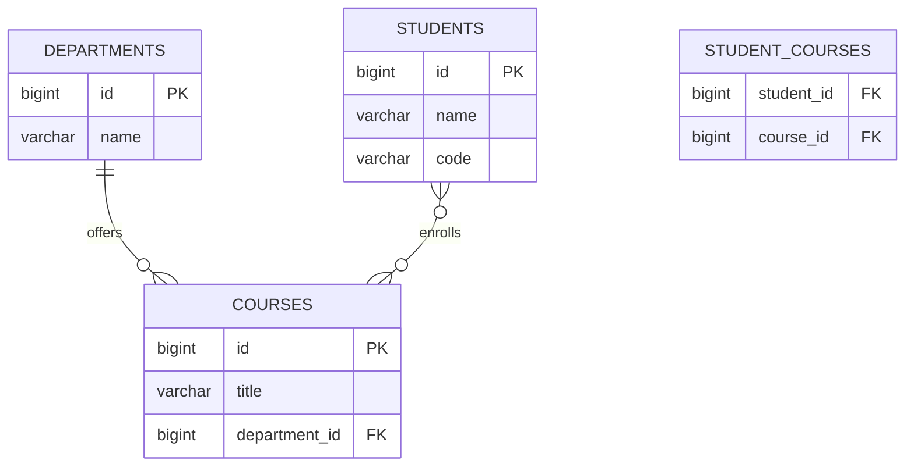

# Taller 10: Java Persistence API (JPA) - Clean Persistence
## Parte I: Comprensión y Análisis del Demo Existente
**Universidad del Cauca - Laboratorio de Ingeniería de Software II**

---

### Actividad 1.1. Reconocimiento de la Arquitectura

#### Tabla 1: Elementos del Demo y sus Responsabilidades

| Elemento | Archivo o Clase | Responsabilidad |
| :--- | :--- | :--- |
| **Presentación** | `SchoolController` | Expone los endpoints de la API (HTTP REST o interfaz), recibe y deserializa las peticiones de usuario, valida formatos de entrada y delega la ejecución de los casos de uso a la capa de aplicación sin conocer detalles de persistencia. |
| **Aplicación** | `SchoolService` | Orquesta los casos de uso del negocio (matricular estudiante, crear curso, etc.). Coordina transacciones y utiliza los contratos abstractos de repositorio (`StudentRepository`, `CourseRepository`, etc.), sin acoplarse a JPA ni a Spring Data. |
| **Dominio** | `Student`, `Course`, `Department` | Representan el núcleo de la lógica de negocio y las reglas invariantes del dominio educativo. Son modelos puros en Java (POJOs), completamente libres de anotaciones tecnológicas como `@Entity`, `@Id` o `@Table`. |
| **Contrato de Repositorio** | `StudentRepository` | Define la interfaz de operaciones de persistencia orientadas a la colección de negocio (e.g. `save()`, `findById()`, `findAll()`). Expresa contratos limpios y desacoplados de la tecnología de base de datos o framework ORM. |
| **Implementación Concreta** | `StudentRepositoryJpa` | Implementa el contrato `StudentRepository`. Traduce llamadas del dominio hacia llamadas a la base de datos apoyándose en Spring Data JPA (`SpringStudentDataRepository`) y utilizando el `DomainMapper` para convertir entre entidades y registros JPA. |
| **Modelo JPA** | `StudentRecord`, `CourseRecord`, `DepartmentRecord` | Entidades tecnológicas anotadas con Jakarta Persistence (`@Entity`, `@Table`, `@Id`, `@ManyToOne`, etc.). Modela la estructura exacta de las tablas de la base de datos relacional y gestiona el ciclo de vida del contexto de persistencia. |
| **Conversión de Modelos** | `DomainMapper` | Actúa como traductor bidireccional entre las clases puras del dominio (`Student`) y las entidades de persistencia JPA (`StudentRecord`). Garantiza que el dominio nunca se contamine con detalles de base de datos y que JPA opere únicamente con sus entidades administradas. |

---

#### Respuestas a las Preguntas de la Actividad 1.1

##### 1. ¿Qué ocurriría si se agregara `@Entity` directamente a la clase de dominio `Student`?
* **Contaminación tecnológica (Violación de Separación de Intereses):** El dominio de negocio quedaría estrechamente acoplado al framework de persistencia (Jakarta Persistence / Hibernate).
* **Pérdida de independencia:** Cualquier cambio en la estrategia de persistencia (por ejemplo migrar a NoSQL como MongoDB, Cassandra, o a un almacenamiento por archivos) obligaría a reescribir y refactorizar el núcleo del negocio.
* **Restricciones impuestas por el ORM:** JPA exige un constructor sin argumentos (no-arg constructor) y campos no finales (mutables), lo cual debilita o rompe el principio de encapsulamiento y el diseño de objetos inmutables o con invariantes estrictas en el dominio.
* **Dificultad en pruebas unitarias:** Las pruebas del dominio necesitarían un entorno de persistencia simulado o un contexto JPA en lugar de poder instanciarse y probarse mediante simples POJOs en memoria.

##### 2. ¿Por qué `SchoolService` depende de `StudentRepository` y no directamente de `SpringStudentDataRepository`?
* **Principio de Inversión de Dependencias (DIP - SOLID):** Los módulos de alto nivel (como la lógica de aplicación en `SchoolService`) no deben depender de módulos de bajo nivel (como `SpringStudentDataRepository` que extiende `JpaRepository`). Ambos deben depender de abstracciones (`StudentRepository`).
* **Flexibilidad y testeabilidad:** `SchoolService` puede probarse unitariamente de forma instantánea usando un repositorio simulado en memoria (`InMemoryStudentRepository`) o un Mock, sin necesidad de levantar Spring Context ni bases de datos.
* **Aislamiento arquitectónico:** Si en el futuro se reemplaza Spring Data JPA por JDBC puro, MyBatis, un microservicio gRPC o una base documental, `SchoolService` no sufrirá ningún cambio.

##### 3. ¿Qué responsabilidades tiene `StudentRepositoryJpa` que no deberían estar en `Student`?
* **Manejo del ciclo de vida de persistencia:** Gestionar transacciones (`@Transactional`), sesiones de Hibernate, estado *managed*, *detached*, *transient*.
* **Mapeo de datos (ORM):** Invocar al mapeador (`DomainMapper`) para transformar modelos de dominio en registros JPA y viceversa.
* **Acceso a datos y optimización de consultas:** Manejo de consultas SQL/JPQL, paginación, carga perezosa (*lazy loading*), índices y dialectos de base de datos.
* **Principio de Responsabilidad Única (SRP):** La clase `Student` solo debe ser responsable de las reglas e invariantes del estudiante (validar créditos, nombre, estado académico). No debe saber cómo ni dónde se guardan sus datos.

##### 4. ¿Qué ventajas y costos introduce tener una clase `Student` y otra `StudentRecord`?
* **Ventajas:**
  1. *Desacoplamiento total:* El esquema relacional de la BD puede cambiar (nombres de columnas, tablas intermedias) sin afectar la lógica de negocio ni romper la API del dominio.
  2. *Invariantes protegidas:* La clase `Student` puede imponer constructores estrictos con validaciones de negocio, mientras `StudentRecord` provee la flexibilidad técnica que Hibernate requiere.
  3. *Seguridad arquitectónica:* Las entidades de base de datos no se filtran a la capa de presentación ni al dominio.
* **Costos:**
  1. *Complejidad y código repetitivo (Boilerplate):* Duplicación de clases y atributos (uno para dominio, otro para JPA).
  2. *Mantenimiento de mapeadores:* Es necesario escribir y mantener mappers bidireccionales (`DomainMapper`) para sincronizar ambos modelos.
  3. *Overhead de memoria/CPU insignificante:* Costo de instanciación adicional en cada transformación dominio $\leftrightarrow$ JPA.

##### 5. ¿Qué tendría que cambiar si se reemplazara H2 por PostgreSQL manteniendo el mismo contrato de repositorio?
* **En el código de Dominio y Aplicación (`Student`, `SchoolService`, `StudentRepository`):** **ABSOLUTAMENTE NADA.** La interfaz del repositorio y la lógica de aplicación permanecen 100% idénticas.
* **En la configuración del proyecto:**
  1. Reemplazar la dependencia de `com.h2database:h2` por el driver JDBC de PostgreSQL (`org.postgresql:postgresql`) en `pom.xml`.
  2. Actualizar `application.properties`:
     - `spring.datasource.url=jdbc:postgresql://localhost:5432/saberpro_db`
     - `spring.datasource.username=...`
     - `spring.datasource.password=...`
     - `spring.jpa.database-platform=org.hibernate.dialect.PostgreSQLDialect`
* **En las entidades JPA (`*Record`):** Ajustar las estrategias de generación de identificadores si se requiere (`GenerationType.SEQUENCE` o `IDENTITY`) y tipos de columnas específicas si aplica (e.g., `text` o `jsonb`).

---

### Actividad 1.2. Comprender las Relaciones

#### Preguntas de Análisis
1. **¿Cuál es el lado propietario de la relación entre `DepartmentRecord` y `CourseRecord`?**
   * El lado propietario (*owning side*) es **`CourseRecord`**, porque contiene la clave foránea (`department_id`) y define la anotación `@JoinColumn(name = "department_id")` en su relación `@ManyToOne`. En JPA, el lado propietario siempre es aquel que controla la columna física de la clave foránea en la base de datos.
2. **¿Por qué `mappedBy = "department"` aparece en la relación uno a muchos?**
   * Aparece en `DepartmentRecord` para indicar que es el lado **inverso o no propietario** de la relación bidireccional. La cadena `"department"` hace referencia al atributo `private DepartmentRecord department;` en la clase `CourseRecord`. Le indica a Hibernate que no cree una tabla intermedia adicional, sino que reutilice la clave foránea que ya existe en la tabla `courses`.
3. **¿Qué función cumple `@JoinColumn` en la relación muchos a uno?**
   * Especifica el nombre de la columna física que actuará como clave foránea en la tabla correspondiente (por ejemplo, `department_id` o `author_id`), definiendo además restricciones de integridad referencial como `nullable = false` o `unique = true`.
4. **¿Qué tabla intermedia utiliza la relación muchos a muchos?**
   * En el caso de Cursos y Estudiantes, se utiliza una tabla de unión (join table) como `student_courses` (o `course_students`), configurada con `@JoinTable` con dos claves foráneas: una que apunta a la clave primaria de `students` (`student_id`) y otra que apunta a `courses` (`course_id`).
5. **¿Qué diferencia existe entre la colección de cursos de un departamento y la colección de cursos de un estudiante?**
   * **Colección del departamento (`Department` $\rightarrow$ `Course`):** Es una relación **Uno a Muchos (`@OneToMany`)**. Un curso pertenece estrictamente a un único departamento (clave foránea única `department_id` dentro de la tabla `courses`).
   * **Colección del estudiante (`Student` $\rightarrow$ `Course`):** Es una relación **Muchos a Muchos (`@ManyToMany`)**. Un estudiante cursa múltiples materias y un curso tiene matriculados múltiples estudiantes; por tanto, no se puede almacenar como una simple columna en una tabla y requiere obligatoriamente una **tabla intermedia**.

---

### Actividad 1.3. Comprender la Herencia

#### 1. ¿Qué hace `@Inheritance(strategy = InheritanceType.JOINED)`?
La estrategia `JOINED` crea una tabla para la clase raíz base y una tabla especializada para cada subclase:
* La tabla base almacena todos los atributos comunes a la jerarquía (`id`, campos generales).
* Cada tabla hija almacena únicamente sus atributos propios o diferenciadores.
* La clave primaria de la tabla hija es a la vez una **clave foránea** que referencia a la clave primaria de la tabla base. Al consultar una subclase, JPA realiza automáticamente una operación `JOIN` entre ambas tablas.

#### 2. Atributos en la tabla base vs tablas especializadas:
* **Tabla base (`persons` o `questions`):** Guarda atributos generales (ej. `id`, `name`, `email` en Personas; o `id`, `statement`, `difficulty`, `status`, `author_id` en Preguntas).
* **Tablas especializadas (`students`, `instructors` o `mc_questions`, `tf_questions`):** Guardan atributos específicos (ej. `code`, `grade` en Estudiantes; o lista de opciones/clave foránea en Selección Múltiple, y `expected_truth_value` en Falso/Verdadero).

#### 3. Comparación entre clases de dominio y clases JPA de la jerarquía:
* En el dominio, la herencia modela comportamiento y polimorfismo lógico puro (`Question.validateForReview()`).
* En JPA, la jerarquía modela cómo se normalizan las filas y relaciones relacionales en el motor SQL, manejando columnas discriminadoras y restricciones de integridad.

#### 4. Comparación de Estrategias de Herencia en JPA:

| Estrategia | Descripción Relacional | Ventajas | Desventajas |
| :--- | :--- | :--- | :--- |
| **`SINGLE_TABLE`** | Toda la jerarquía se almacena en **una sola tabla** con una columna discriminadora (`DTYPE`). | Muy rápida; no requiere `JOIN`s en consultas polimórficas. | Las columnas específicas de subclases deben admitir valores nulos (`NULL`), impidiendo restricciones `NOT NULL`. La tabla se vuelve ancha y poco normalizada. |
| **`JOINED`** (Elegida) | Tabla base para atributos comunes + tablas hijas para cada especialización vinculadas por PK/FK. | Base de datos completamente **normalizada**, integridad referencial estricta (`NOT NULL` en atributos de subclases), extensible. | Consultas polimórficas requieren operaciones `JOIN`, lo que puede tener un costo menor en tablas con millones de registros. |
| **`TABLE_PER_CLASS`** | Cada clase concreta tiene su propia tabla completa con todos sus atributos (heredados y propios). | No hay campos nulos ni tablas base vacías. | Consultas polimórficas sobre la clase base requieren sentencias `UNION` complejas e ineficientes. Las claves primarias no pueden autoincrementarse de forma aislada por tabla. |

---

### Preguntas de Reflexión para la Sustentación (Página 10 del PDF)

#### 1. ¿Qué ventajas y desventajas tiene mantener dos modelos, uno de dominio y otro de persistencia?
* **Ventajas:**
  * **Independencia del negocio:** La lógica del banco de preguntas no se ve afectada si JPA, Hibernate o la base de datos cambian.
  * **Encapsulamiento:** El dominio puede modelar constructores de negocio con invariantes válidas sin necesidad de getters/setters públicos para cada campo.
  * **Seguridad:** Previene ataques de sobre-asignación (*mass assignment*) y evita exponer el modelo físico a las capas superiores.
* **Desventajas:**
  * Duplicación de código (*boilerplate*) para clases y mapeadores.
  * Sobrecarga de sincronización al agregar un nuevo campo a una entidad.

#### 2. ¿Qué cambios serían necesarios si el sistema dejara de utilizar JPA?
* Únicamente se reemplazaría el paquete `infrastructure/jpa/` por un paquete nuevo (ej. `infrastructure/mongodb/` o `infrastructure/jdbi/`).
* Se implementarían las mismas interfaces de repositorio de dominio (`QuestionRepository`, `UserRepository`, `QuizRepository`) utilizando la nueva tecnología.
* Las capas `domain`, `application` y `api` permanecerían **100% inalteradas**.

#### 3. ¿Cuándo conviene una relación muchos a muchos directa y cuándo es mejor crear una entidad asociativa?
* **Directa (`@ManyToMany`):** Conviene cuando la asociación entre dos entidades es un simple vínculo sin información adicional (ejemplo: `Question` y `Competency`, donde solo se requiere saber si la pregunta evalúa la competencia).
* **Entidad Asociativa (`QuestionCompetency`):** Conviene cuando el vínculo tiene atributos propios de negocio, como el **peso porcentual** de la competencia en la pregunta, la fecha de asignación o el autor de la vinculación. En ese caso, la tabla intermedia se transforma en una entidad con dos relaciones `@ManyToOne`.

#### 4. ¿Qué problemas pueden aparecer al recuperar asociaciones perezosas (LAZY) fuera de una transacción?
* Ocurre la clásica excepción `LazyInitializationException` de Hibernate. Cuando una sesión de JPA o transacción se cierra al salir del servicio, los proxies perezosos no inicializados quedan desvinculados (*detached*). Si la capa de presentación intenta serializarlos a JSON fuera de la transacción, el proxy falla al no tener conexión activa a la BD. Esto se resuelve mapeando a DTOs explícitos dentro de la capa de aplicación con `@Transactional(readOnly = true)`.

#### 5. ¿Qué estrategia de herencia elegirían si el sistema incorpora muchos tipos de preguntas con atributos y reglas diferentes?
* **Estrategia recomendada: `JOINED`:** Es la estrategia óptima para sistemas educativos estandarizados. Permite que preguntas complejas (como Selección Múltiple con distractores, Falso/Verdadero, Preguntas de Emparejamiento, Código Fuente) mantengan sus campos específicos con restricciones `NOT NULL` e integridad de clave foránea en sus tablas especializadas, compartiendo el enunciado, autor y estado en la tabla base `questions`.

#### 6. ¿Por qué la persistencia de una pregunta y la validación de su ciclo de vida son responsabilidades distintas?
* **Persistencia (`QuestionRepositoryJpa`):** Se enfoca en el *cómo almacenar y recuperar*: mapear campos a SQL, generar claves primarias, ejecutar sentencias `INSERT`/`UPDATE` y garantizar atomicidad transaccional.
* **Ciclo de Vida (`Question.java` y `QuestionService`):** Se enfoca en el *por qué y cuándo*: define las reglas de negocio, como impedir que una pregunta pase a revisión sin al menos 2 opciones de respuesta y 1 respuesta correcta, o prohibir que una pregunta no aprobada ni publicada se incorpore en un simulacro de evaluación.
